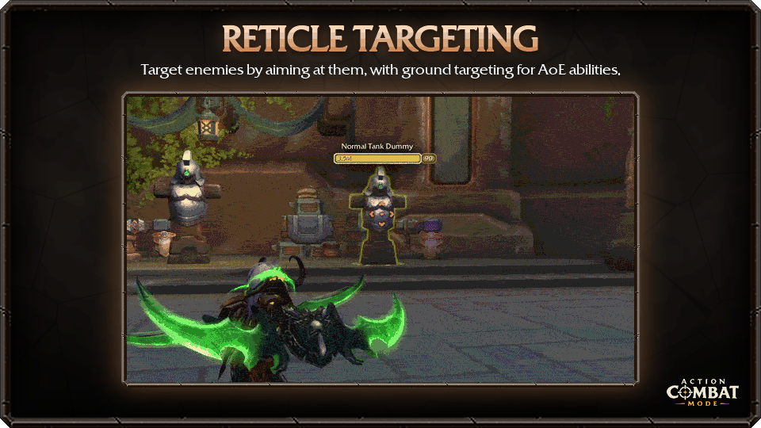
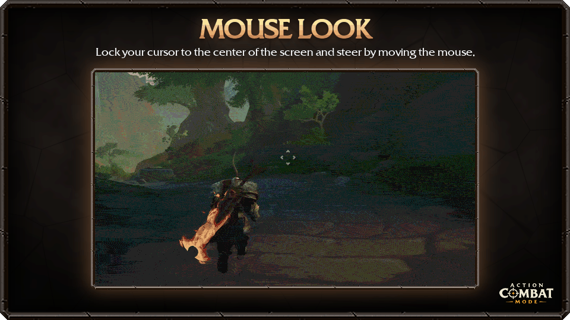
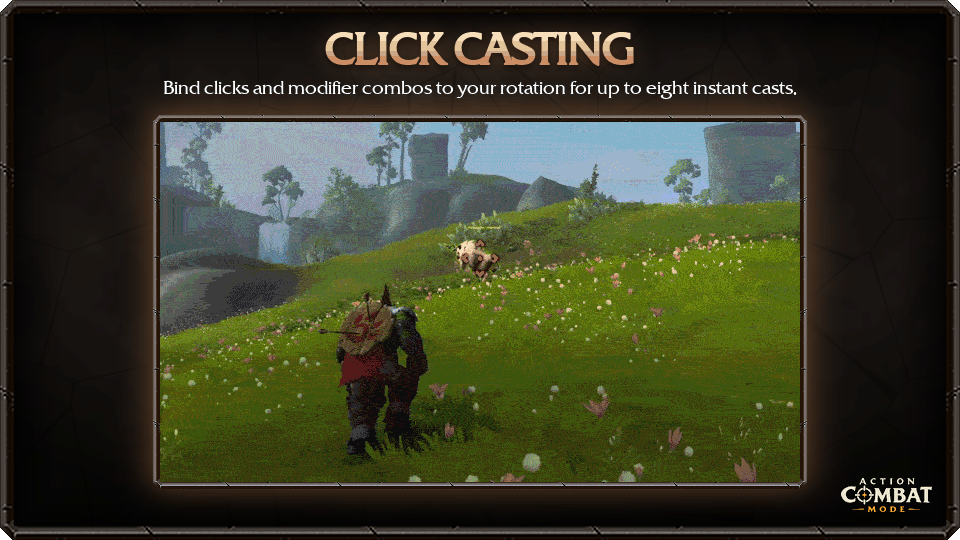
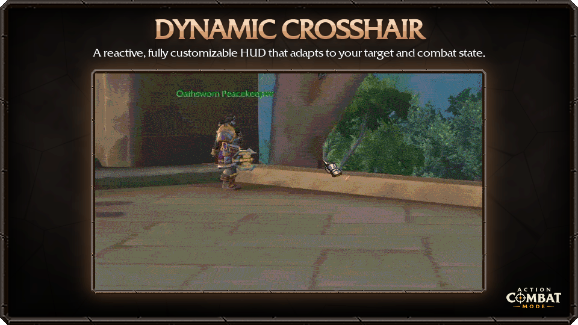
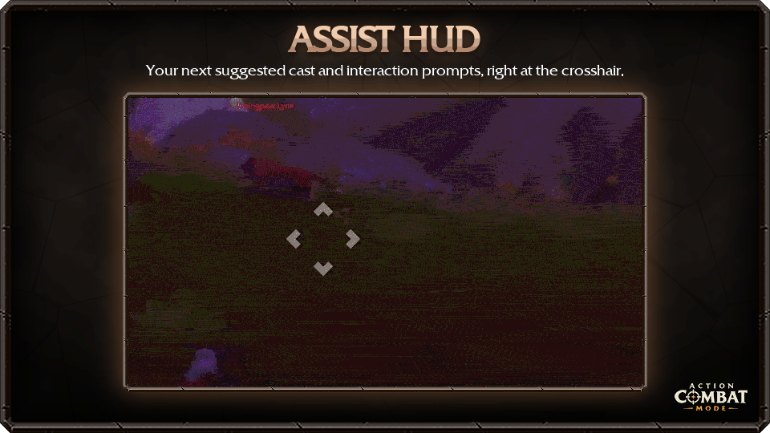
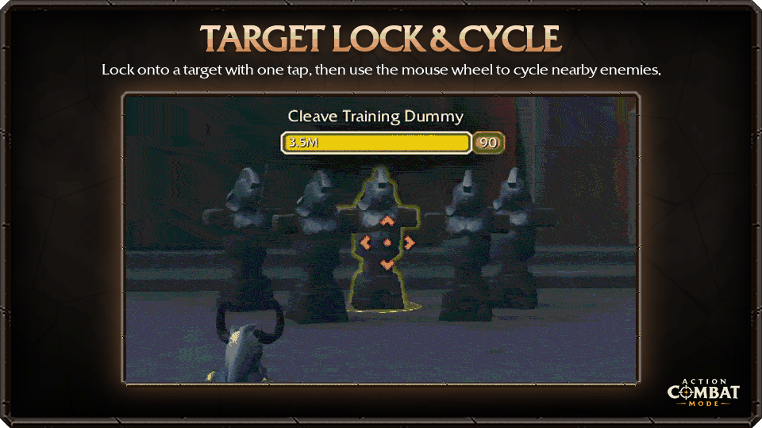
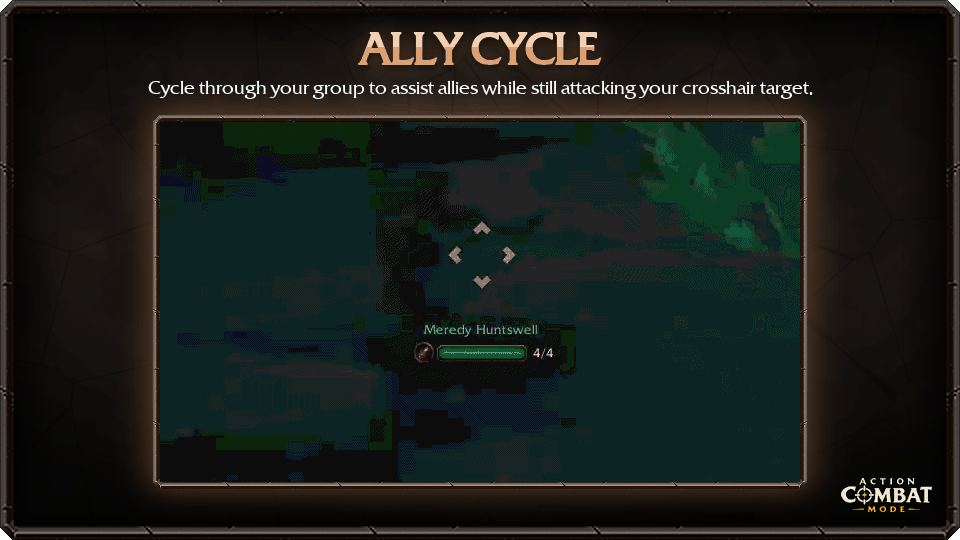
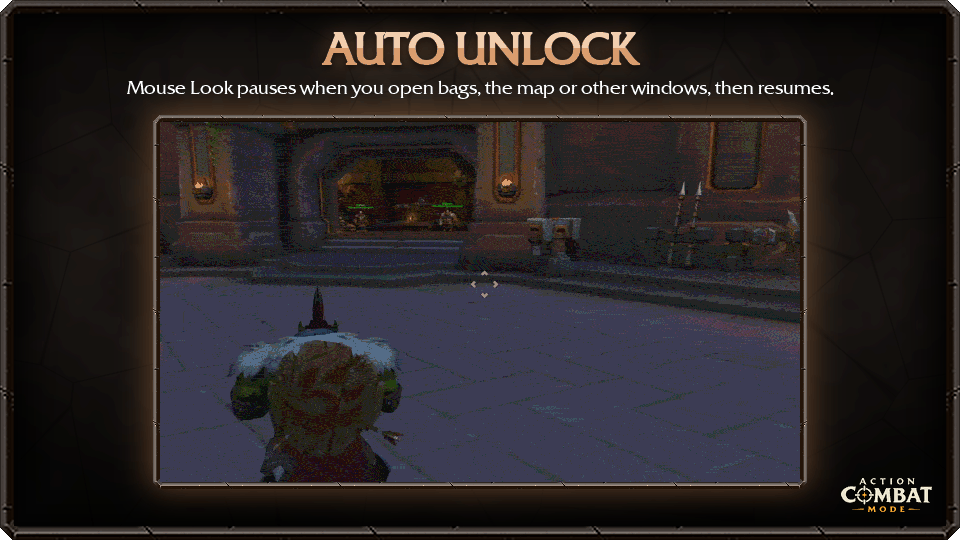
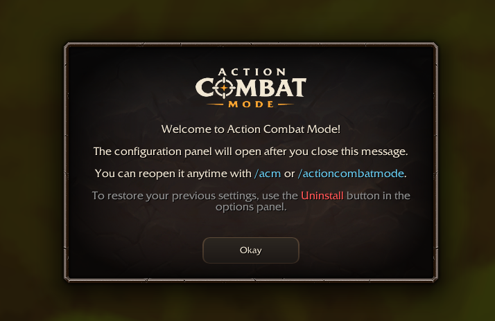

  

<strong>Action Combat Mode</strong> brings modern action-game controls to <em>World of Warcraft</em>, replacing traditional tab-targeting with intuitive aiming, more engaging controls, and immersive combat.

 

##  FEATURES

  

  

  

  

  

  

  

  

##  DOWNLOAD

Grab it on [**CurseForge**](https://www.curseforge.com/wow/addons/combat-mode) or [**Wago Addons**](https://addons.wago.io/addons/combat-mode).

 

##  INSTRUCTIONS

After installing the AddOn, you'll be greeted by this message. Click Okay to proceed and follow the Setup Wizard.

  

 

##  SUPPORT

You can report bugs, request features and provide feedback over on our [**Discord**](https://www.discord.gg/5mwBSmz).

 

##  ARCHITECTURE

Action Combat Mode is organized by **domain**. Runtime lives under `CombatMode/Core/`; settings under `CombatMode/UI/`; static tables under `CombatMode/Constants/`.

| Domain | Owns |
|--------|------|
| **Runtime** | AddOn shell, events, CVars, binding queue, bootstrap (`Core/Runtime/`) |
| **FreeLook** | Mouse look / mouselook state + auto cursor unlock |
| **Crosshair** | Reticle, Assist HUD (next-cast suggestion and interactable indicator), Target Lock focus marker, cast animations |
| **ClickCasting** | Mouse override bindings + targeting macro builder |
| **AllyCycle** | Party/raid ally cycling + Ally HUD (secure UP/DOWN, help/harm macros) |
| **Options toolkit** | Standalone options window + editors (`UI/Options/`, `UI/Editors/`) |

Load order and public entry points: **[STRUCTURE.md](STRUCTURE.md)**. Agent/contributor rules: **[CLAUDE.md](CLAUDE.md)**.

 

##  CONTRIBUTING

You can submit a PR with your contributions to [**Action Combat Mode's repository on GitHub**](https://github.com/djsmithdev/combatmode).

### Developer quickstart

1. Clone and install the addon into your Retail `Interface/AddOns` folder for local testing.
2. Skim the [architecture table](#architecture) above, then [STRUCTURE.md](STRUCTURE.md) for load order.
3. Follow [CONTRIBUTING.md](CONTRIBUTING.md) — especially the **first-hour path** (change a toggle, add a constant, secret-value rules).
4. Run a focused manual pass from [TESTING.md](TESTING.md) for your changed features.
5. Open a PR and complete `.github/PULL_REQUEST_TEMPLATE.md`. Use [RELEASE.md](RELEASE.md) when shipping a version.

### Code Style & Linting

- Install [StyLua](https://github.com/JohnnyMorganz/StyLua) and [Selene](https://github.com/Kampfkarren/selene).
- Script index helper: `pwsh ./scripts/help.ps1`
- Setup sanity helper: `pwsh ./scripts/dev-check.ps1`
- Default changed-files helper: `pwsh ./scripts/lint-changed.ps1`
- Default local gate (changed files): `pre-commit run --files <changed files>`
- Tool-specific debug checks: `stylua --check <paths>`, `selene --config selene.toml <paths>`
- Install pre-commit hooks (recommended):
  - `pip install pre-commit`
  - `pre-commit install`
  - Release prep / full sweep only: `pre-commit run --all-files`

 