

  

<strong>Action Combat Mode</strong> brings modern action-game controls to <em>World of Warcraft</em>, replacing traditional tab-targeting with intuitive aiming, more engaging controls, and immersive combat.

 

##  FEATURES

  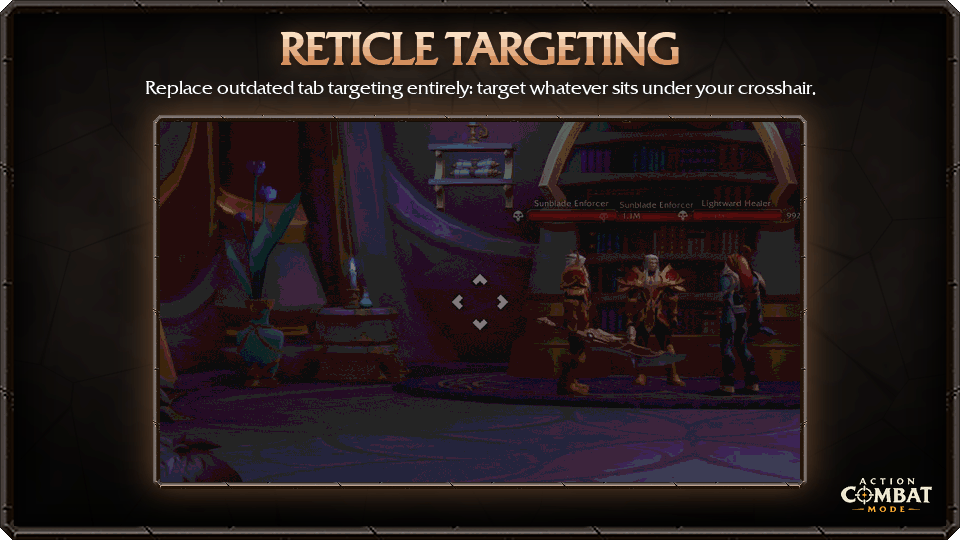

  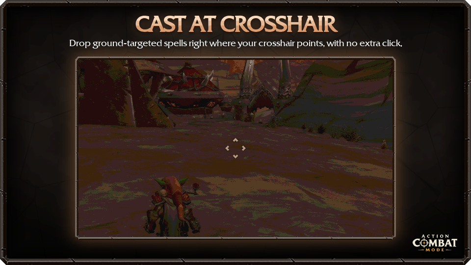

  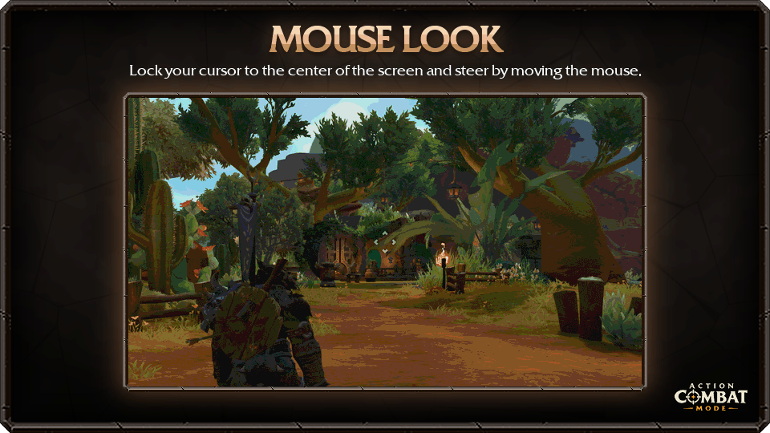

  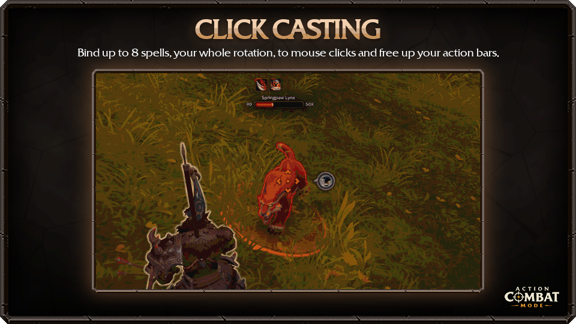

  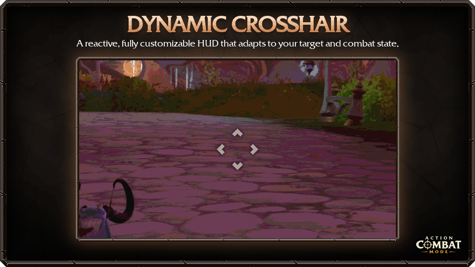

  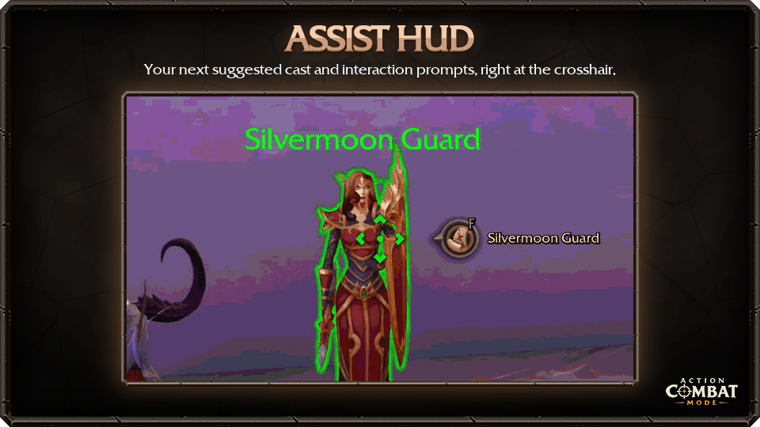

  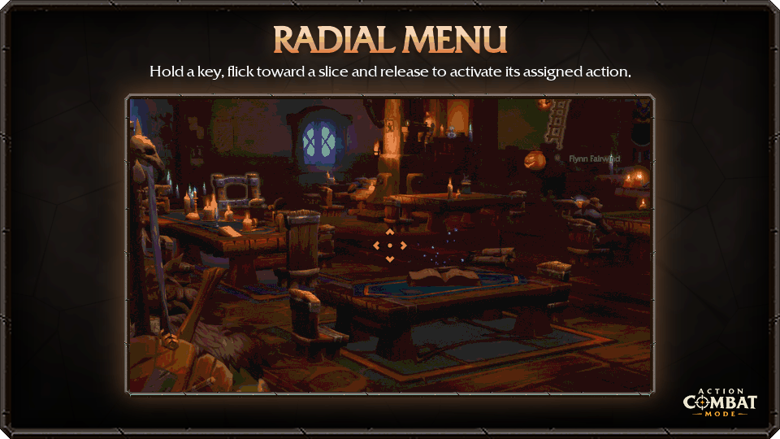

  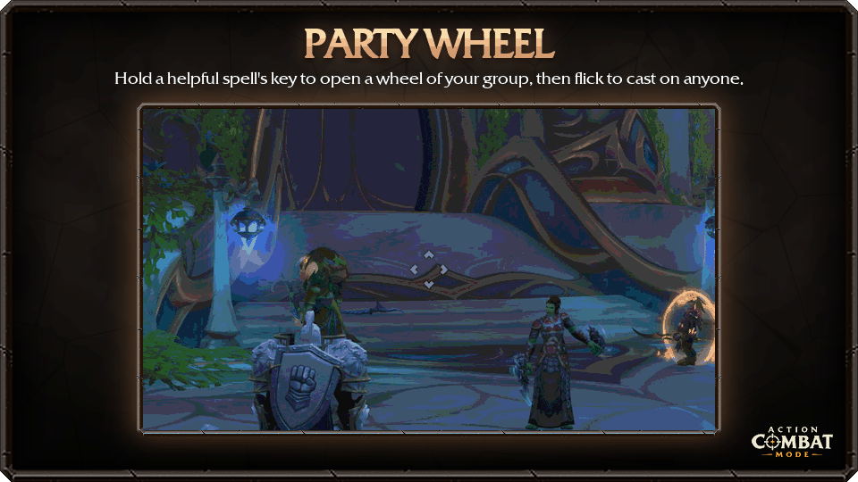

  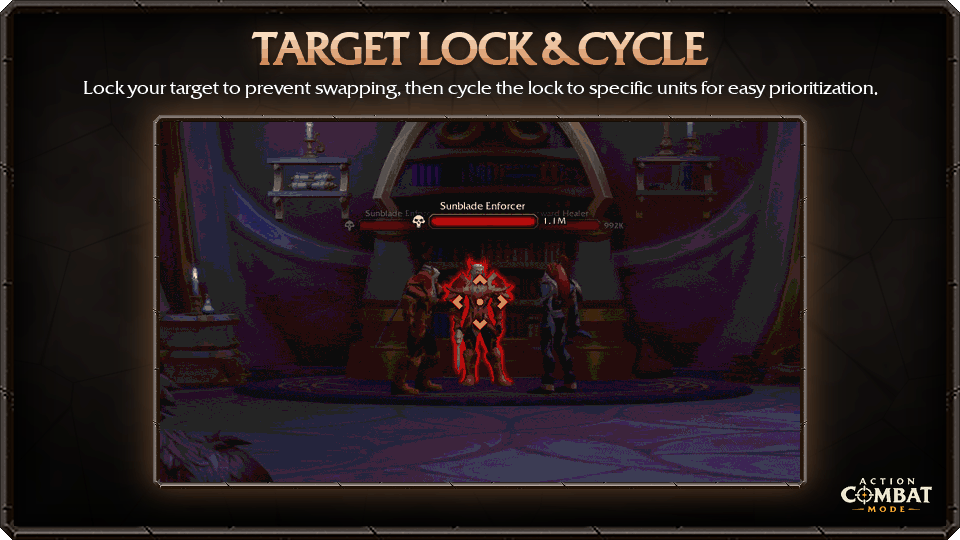

  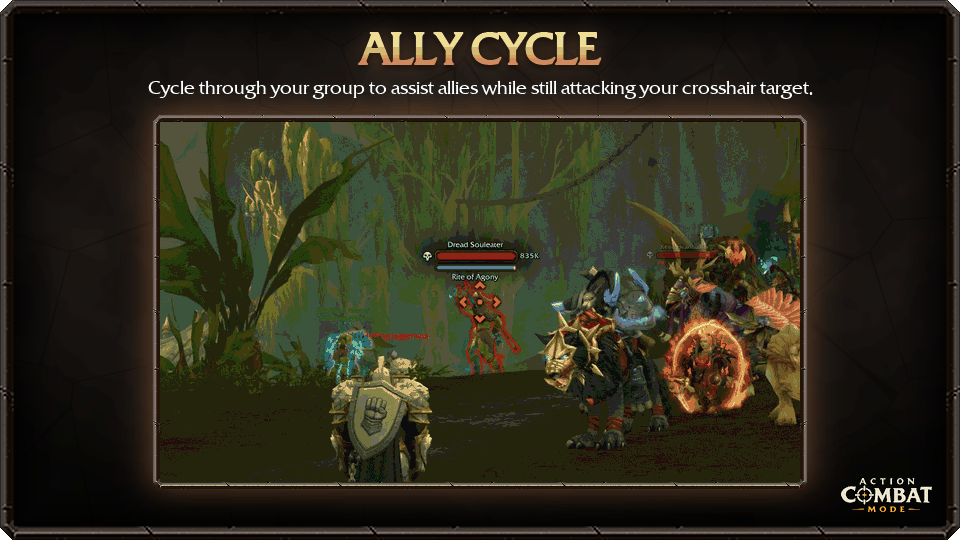

  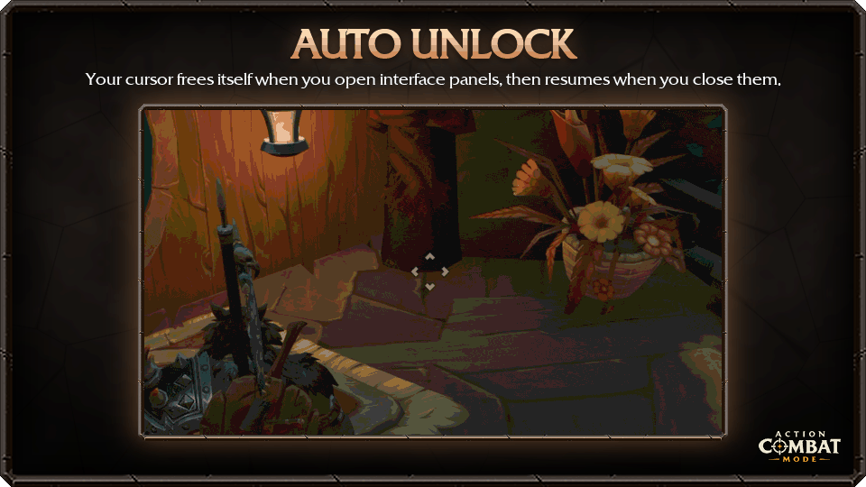

##  DOWNLOAD

Grab it on [**CurseForge**](https://www.curseforge.com/wow/addons/combat-mode) or [**Wago Addons**](https://addons.wago.io/addons/combat-mode).

 

##  INSTRUCTIONS

After installing the AddOn, you'll be greeted by this message. Click Okay to proceed and follow the Setup Wizard.

  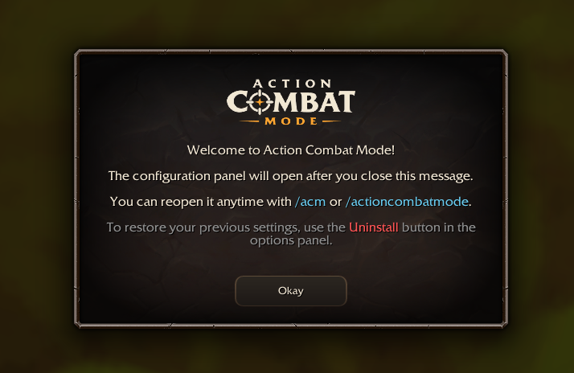

 

##  SUPPORT

You can report bugs, request features and provide feedback over on our [**Discord**](https://www.discord.gg/5mwBSmz).

 

##  LICENSE

Free to use, not to redistribute or sell. Contributions through pull requests are welcome. See the [LICENSE](LICENSE) for the full terms.

 

##  ARCHITECTURE

Action Combat Mode is organized by **domain**. Runtime lives under `CombatMode/Core/`; settings under `CombatMode/UI/`; static tables under `CombatMode/Constants/`.

| Domain | Owns |
|--------|------|
| **Runtime** | AddOn shell, events, CVars, binding queue, bootstrap (`Core/Runtime/`) |
| **FreeLook** | Mouse Look state, auto cursor unlock, flip camera, vignette |
| **Crosshair** | Reticle, Assist HUD (next-cast suggestion and interactable indicator), Target Lock marker, cast animations |
| **ClickCasting** | Mouse/key override bindings, Reticle Targeting macros, composed macros |
| **AllyCycle** | Party/raid ally cycling + Ally HUD (secure Next/Previous, help/harm macros) |
| **RadialMenu** | Radial Menu wheels and the Party Wheel |
| **Options / Wizard** | Standalone options window, editors and the first-run setup wizard (`UI/`) |

Load order and public entry points: **[STRUCTURE.md](STRUCTURE.md)**.

 

##  CONTRIBUTING

Pull requests to [**Action Combat Mode's repository on GitHub**](https://github.com/djsmithdev/combatmode) are welcome. See **[CONTRIBUTING.md](CONTRIBUTING.md)** for setup, the PR flow and the automatic checks; architecture and coding rules are in **[CLAUDE.md](CLAUDE.md)**.

 
